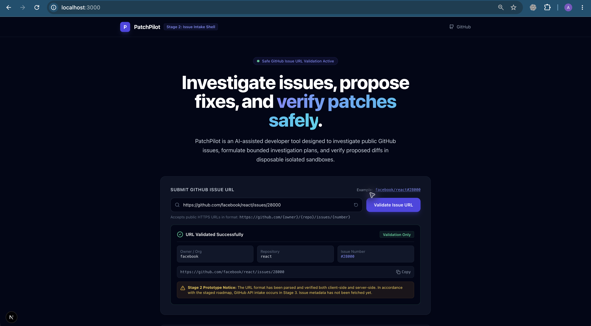
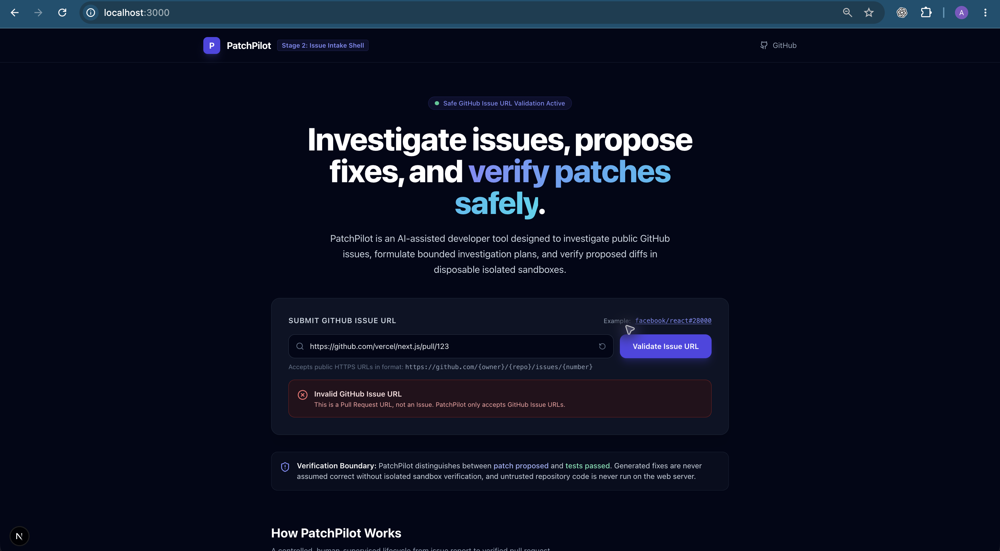

# PatchPilot

> **AI-assisted GitHub issue investigation and patch-verification tool.**

PatchPilot is an open-source developer tool built to bridge the gap between AI code generation and reliable software engineering. Given a public GitHub issue, PatchPilot extracts structured context, formulates an explainable investigation plan, suggests a minimal unified diff, and verifies the patch in a disposable, isolated sandbox before a human engineer ever considers submitting a draft pull request.

[](https://github.com/ABhardwaj28/PatchPilot)
[](https://github.com/ABhardwaj28/PatchPilot/blob/main/LICENSE)
[](https://github.com/ABhardwaj28/PatchPilot)
[](https://github.com/ABhardwaj28/PatchPilot)

---

## Quick Links & Repository URLs

- **GitHub Repository:** [https://github.com/ABhardwaj28/PatchPilot](https://github.com/ABhardwaj28/PatchPilot)
- **Issue Tracker:** [https://github.com/ABhardwaj28/PatchPilot/issues](https://github.com/ABhardwaj28/PatchPilot/issues)
- **Pull Requests:** [https://github.com/ABhardwaj28/PatchPilot/pulls](https://github.com/ABhardwaj28/PatchPilot/pulls)
- **Architecture & Technical Decisions:** [docs/DECISIONS.md](docs/DECISIONS.md)
- **Security Architecture & Threat Model:** [docs/SECURITY_MODEL.md](docs/SECURITY_MODEL.md)
- **6-Week Phased Roadmap:** [docs/ROADMAP.md](docs/ROADMAP.md)
- **Contributing Guidelines:** [CONTRIBUTING.md](CONTRIBUTING.md)
- **Security Policy & Disclosures:** [SECURITY.md](SECURITY.md)

---

## What PatchPilot Is and Is Not

### What PatchPilot Is
- An **investigation assistant** that reads public GitHub issues and gathers bounded repository context.
- A **patch proposer** that outputs readable unified diffs for developer review.
- A **verification system** designed to run regression tests in disposable, isolated worker environments.
- A **human-in-the-loop tool** requiring explicit human confirmation before opening draft pull requests.

### What PatchPilot Is Not
- **Not an autonomous auto-merger:** PatchPilot will never merge pull requests or deploy code automatically.
- **Not a black-box fixer:** We do not claim generated fixes are guaranteed correct. Passing tests are evidence, not proof of correctness.
- **Not an arbitrary command runner:** PatchPilot will not execute unsanitized shell commands or run untrusted code on the web host.

---

## Current Status: Stage 5 Completed (Ready for Stage 6)

PatchPilot has completed **Stage 0**, **Stage 1**, **Stage 2**, **Stage 3**, **Stage 4**, and **Stage 5** of its [6-Week Roadmap](docs/ROADMAP.md).

### Implemented Capabilities (Stage 5 Checkpoint)
- **Public Open-Source Repository:** Hosted on GitHub at [ABhardwaj28/PatchPilot](https://github.com/ABhardwaj28/PatchPilot) under the MIT License.
- **Next.js 15 App Shell:** Built with TypeScript, Tailwind CSS, dark-mode accessible theme, and responsive layout.
- **Dual-Layer Safe Issue URL Validation:** Client-side UX validation and server-side trust boundary at `POST /api/validate-issue`. Strictly enforces HTTPS, `github.com` domain, and positive issue integers; blocks SSRF, credentials, and pull-request URLs.
- **Server-Side GitHub API Integration:** Dedicated Octokit client service (`POST /api/issue-metadata`) safely extracts public issue and repository metadata (title, state, description excerpt, labels, comments, author, stars, forks, language).
- **Bounded Repository Context Retrieval:** Server-side engine (`POST /api/investigate-issue` & `src/lib/github/context-collector.ts`) that collects read-only git tree context without cloning or executing repository code.
- **Deterministic Heuristic Relevance Scoring:** Scores files using explainable signals (+50 for files mentioned in issue text, +15 for filename keyword matches, +10 for core source modules), accompanied by human-readable selection rationales.
- **Strict Quota & Safety Boundaries:** Enforces strict limits: max 5 selected files, 30 KB per file (with safe truncation), 100 KB total context payload, max 1,000 scanned tree items, and max 8 directory nesting levels.
- **Server-Side LLM Provider Adapter (`POST /api/propose-patch`):** Decoupled provider interface supporting deterministic offline Mock mode and live Google Gemini (`@google/genai` with `gemini-3.8-flash`).
- **Defensive Prompt Delimitation:** Wraps untrusted issue text and code inside strict delimiters with explicit system instructions prohibiting execution of user-supplied commands or prompt overrides.
- **Strict Path Traversal & Schema Validation:** Rejects absolute paths (`/etc/...`), directory traversal (`../`), out-of-context file modifications, and malformed diffs.
- **Accessible Diff Review UI:** Displays syntax-colored unified diffs with additions/deletions, risk rating, explanation card, clipboard copy, and `.patch` file download.
- **Transparent Verification Labeling:** Prominent mandatory disclaimer (*"Status: Proposed — not executed or verified"*).
- **Automated Verification:** 71/71 unit and integration tests passing across Vitest, ESLint 9, and TypeScript compilation.

### Feature Status Matrix

| Capability | Status | Stage | Notes |
| :--- | :---: | :---: | :--- |
| Next.js App Shell & Design System | :white_check_mark: Implemented | Stage 1 | Dark-mode accessible landing page and health route |
| Smoke Tests & Static Analysis | :white_check_mark: Implemented | Stage 1 | Vitest, ESLint 9, TypeScript type checking |
| Open Source Governance & Security Docs | :white_check_mark: Implemented | Stage 1 | MIT License, CONTRIBUTING, SECURITY, PR Template |
| GitHub Issue URL Validation | :white_check_mark: Implemented | Stage 2 | Strict URL parsing (HTTPS, supported domains, no SSRF, dual client & server validation) |
| GitHub API Metadata Extraction | :white_check_mark: Implemented | Stage 3 | Server-side Octokit client with rate-limiting, safe rendering, and privacy notice |
| Bounded Context Retrieval & Investigation Plan | :white_check_mark: Implemented | Stage 4 | Deterministic heuristics, explainability tags, strict size/count limits, no code execution |
| LLM Provider Adapter & Diff Viewer | :white_check_mark: Implemented | Stage 5 | Schema validation, path traversal guard, mock & Gemini provider, diff download |
| Isolated Containerized Test Worker | :calendar: Planned | Stage 6 | Ephemeral sandboxes, zero network, non-root user |
| Human-Gated Draft PR Creation | :calendar: Planned | Stage 7 | Scoped tokens, explicit confirmation gate, draft PRs only |
| Auto-merging to Main Branch | :no_entry_sign: Not Available | — | Deliberately excluded by security policy |
| Host-level Untrusted Code Execution | :no_entry_sign: Not Available | — | Strictly forbidden; sandboxing mandatory |

---

## Tech Stack

- **Frontend & App Framework:** [Next.js 15](https://nextjs.org/) (App Router), [React 19](https://react.dev/), [TypeScript 5](https://www.typescriptlang.org/)
- **Styling:** [Tailwind CSS 3](https://tailwindcss.com/)
- **Icons:** [Lucide React](https://lucide.dev/)
- **Testing:** [Vitest 3](https://vitest.dev/), [React Testing Library](https://testing-library.com/), [jsdom](https://github.com/jsdom/jsdom)
- **Linting & Quality:** [ESLint 9](https://eslint.org/) with `next/core-web-vitals`

---

## Prerequisites

- **Node.js:** `>= 20.18.2` (tested with v24.21.0)
- **npm:** `>= 10.0.0`
- **Git:** `>= 2.40.0`

---

## Local Setup & Development

1. **Clone the repository:**
   ```bash
   git clone https://github.com/ABhardwaj28/PatchPilot.git
   cd PatchPilot
   ```

2. **Install dependencies:**
   ```bash
   npm install
   ```

3. **Configure Environment Variables:**
   ```bash
   cp .env.example .env.local
   ```
   *Note: `.env.local` is strictly ignored by Git. No real secrets or API keys are required for Stages 1 through 4.*

4. **Start the local development server:**
   ```bash
   npm run dev
   ```
   Open [http://localhost:3000](http://localhost:3000) in your browser.

---

## Local Endpoints & Interactive URLs

When running the application locally (`npm run dev`), the following endpoints and URLs are accessible:

| URL / Endpoint | Method | Description |
| :--- | :---: | :--- |
| [http://localhost:3000](http://localhost:3000) | `GET` | Main Web Application UI & Interactive Investigation Console |
| [http://localhost:3000/api/health](http://localhost:3000/api/health) | `GET` | Health check endpoint returning runtime status and uptime |
| [http://localhost:3000/api/validate-issue](http://localhost:3000/api/validate-issue) | `POST` | Dual-layer URL parser and security validation boundary |
| [http://localhost:3000/api/issue-metadata](http://localhost:3000/api/issue-metadata) | `POST` | Server-side Octokit client fetching sanitized public issue metadata |
| [http://localhost:3000/api/investigate-issue](http://localhost:3000/api/investigate-issue) | `POST` | Bounded repository context retrieval & deterministic relevance heuristics |
| [http://localhost:3000/api/propose-patch](http://localhost:3000/api/propose-patch) | `POST` | Server-side LLM patch proposal generation with strict path traversal & schema guards |

---

## Automated Checks & Verification

PatchPilot enforces strict automated quality gates:

```bash
# Run unit and component smoke tests
npm test

# Run tests in interactive watch mode
npm run test:watch

# Verify TypeScript type correctness
npm run type-check

# Run ESLint across all source files
npm run lint

# Build production bundle
npm run build

# Start production server
npm start
```

---

## Environment Variables

All configuration is managed through environment variables. See [.env.example](.env.example) for documentation:

| Variable | Description | Default / Example | Required in Stages 1–4 |
| :--- | :--- | :--- | :---: |
| `NODE_ENV` | Runtime environment | `development` | No |
| `PORT` | Local web port | `3000` | No |
| `GITHUB_TOKEN` | Optional GitHub PAT for higher API rate limits | Placeholder in `.env.example` | No |
| `AI_PROVIDER` | LLM provider adapter (`mock`, `openai`, etc.) | `mock` | No |
| `AI_API_KEY` | Provider API key | Placeholder in `.env.example` | No |

---

## Security & Privacy

For full security architecture and disclosure guidelines, see:
- [SECURITY.md](SECURITY.md) — Security policy and vulnerability reporting.
- [docs/SECURITY_MODEL.md](docs/SECURITY_MODEL.md) — Threat boundaries, data classification, and sandbox isolation guarantees.
- [docs/DECISIONS.md](docs/DECISIONS.md) — Architectural Decision Records (ADRs).

**Key principles:**
- Zero token leakage to client-side bundles or repository files.
- Untrusted repository code never runs on the web host.
- Human review is strictly required before any GitHub mutation.

---

## Screenshots & Demo

### 1. Safe GitHub Issue Intake & URL Validation (Success State)
When an engineer enters a valid public GitHub issue URL (e.g., `https://github.com/facebook/react/issues/28000`), PatchPilot performs instant client-side and server-side validation, parsing the organization, repository, and issue number:



### 2. Defensive Rejection & Error Boundaries (Validation Gate)
PatchPilot strictly rejects non-issue inputs (e.g., pull request URLs like `https://github.com/vercel/next.js/pull/123`, SSRF payloads, non-GitHub domains, and malformed identifiers) before any external API requests or file processing can occur:



---

## 6-Week Roadmap & Progress

PatchPilot is built transparently in phased stages. The table below tracks current progress against the full 6-week roadmap:

| Stage | Milestone / Focus | Status | Checkpoint Commit |
| :---: | :--- | :---: | :--- |
| **Stage 0** | **Environment & Requirements Audit**<br>Rules, roadmap, decisions, and security model. | :white_check_mark: Completed | `chore: document project plan and development environment` |
| **Stage 1** | **App Foundation & Public Repository**<br>Next.js 15, Tailwind CSS, TypeScript, Vitest, MIT License. | :white_check_mark: Completed | `chore: initialize PatchPilot app and documentation` (`bfb155d`) |
| **Stage 2** | **UI Shell & Safe GitHub Issue URL Validation**<br>Strict input parser, Zod validation, dual client/server checks. | :white_check_mark: Completed | `feat: add issue submission and validation UI` (`ca87622`) |
| **Stage 3** | **GitHub API Integration & Issue Metadata**<br>Server-side Octokit client, rate-limits, sanitized display. | :white_check_mark: Completed | `feat: fetch public GitHub issue metadata` (`6594ae7`) |
| **Stage 4** | **Bounded Repository Context Retrieval**<br>Relevance heuristics, file byte/count limits, investigation plan. | :white_check_mark: Completed | `feat: build bounded repository investigation context` (`71b2286`) |
| **Stage 5** | **AI Patch Proposal & Reviewable Diff UI**<br>Isolated LLM adapter, structured output schema, mock provider. | :arrow_forward: **Up Next** | *Awaiting user approval to begin* |
| **Stage 6** | **Isolated Test Worker (Security-Critical)**<br>Ephemeral container sandbox, dropped capabilities, no host network. | :calendar: Planned | — |
| **Stage 7** | **Hardening & Approved Draft PR Workflow**<br>Human confirmation gate, least-privilege tokens, rate-limiting. | :calendar: Planned | — |
| **Stage 8** | **Release Verification & Public Launch**<br>Automated CI pipeline, accessibility audits, demo video. | :calendar: Planned | — |

For full architectural criteria and risk assessments, see [docs/ROADMAP.md](docs/ROADMAP.md).
To contribute, please review [CONTRIBUTING.md](CONTRIBUTING.md).

---

## License

PatchPilot is open-source software licensed under the [MIT License](LICENSE).
