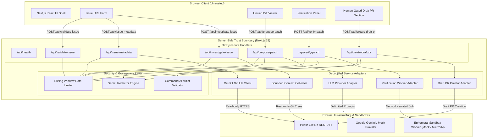

# PatchPilot: System Architecture & Data Flow

This document details the high-level system architecture, service decoupling, data flow, and security boundaries of PatchPilot.

---

## 1. High-Level System Architecture

PatchPilot is architected as a Next.js 15 App Router web application backed by server-side isolated services, decoupled adapters, and physical execution worker boundaries.



---

## 2. End-to-End Investigation & Verification Lifecycle

```mermaid
sequenceDiagram
    autonumber
    actor User as Engineer
    participant UI as Browser UI
    participant Server as Next.js API Routes
    participant GitHub as GitHub API
    participant LLM as LLM Provider
    participant Sandbox as Verification Sandbox

    %% Stage 2 & 3: Intake & Metadata
    User->>UI: Enter GitHub Issue URL
    UI->>Server: POST /api/validate-issue (SSRF check)
    Server-->>UI: 200 OK (Validated owner, repo, issue#)
    UI->>Server: POST /api/issue-metadata
    Server->>GitHub: GET /repos/{owner}/{repo}/issues/{number}
    GitHub-->>Server: Public Issue Metadata
    Server-->>UI: 200 OK (Sanitized Title, Description, State)

    %% Stage 4: Bounded Context
    User->>UI: Click "Investigate Issue"
    UI->>Server: POST /api/investigate-issue
    Server->>GitHub: GET /git/trees/{branch}?recursive=1
    GitHub-->>Server: Git Tree (filtered: max 1000 items)
    Note over Server: Deterministic relevance heuristic scores files.<br/>Limits: max 5 files, 30KB/file, 100KB total.
    Server->>GitHub: GET /contents/{file} (Read-only)
    GitHub-->>Server: File Contents
    Server-->>UI: 200 OK (Bounded Context & Investigation Report)

    %% Stage 5: Patch Proposal
    User->>UI: Click "Generate Proposed Patch"
    UI->>Server: POST /api/propose-patch
    Note over Server: Wraps context in strict delimiters.<br/>System prompt prohibits user override.
    Server->>LLM: Formulate Candidate Patch
    LLM-->>Server: Raw Unified Diff Proposal
    Note over Server: Validates diff syntax and path traversal.
    Server-->>UI: 200 OK (Proposed Diff marked "Unverified")

    %% Stage 6: Isolated Verification
    User->>UI: Select Test Command & Click "Run Isolated Verification"
    UI->>Server: POST /api/verify-patch
    Note over Server: Command Allowlist Check.<br/>Rejects ;, &, |, `, $(), redirects.
    Server->>Sandbox: Dispatch Verification Job (tmpfs, non-root, --network none)
    Sandbox-->>Server: Execution Result (status, duration, stdout, security audit)
    Server-->>UI: 200 OK (Truthful Status: PASSED / FAILED)

    %% Stage 7: Human-Gated Draft PR
    User->>UI: Check review checkboxes & Click "Submit Approved Draft PR"
    UI->>Server: POST /api/create-draft-pr (userConfirmed: true)
    Note over Server: Validates human confirmation.<br/>Generates safe branch name: patchpilot/fix-issue-...
    Server->>GitHub: Create Draft Pull Request (draft: true)
    GitHub-->>Server: Pull Request Created
    Server-->>UI: 200 OK (Draft PR Link: github.com/owner/repo/pull/123)
```

---

## 3. Security Trust Boundaries & Data Flow

| Trust Boundary | Components | Input Validation | Security Controls |
| :--- | :--- | :--- | :--- |
| **Boundary 1: Issue URL Intake** | `POST /api/validate-issue`, `src/lib/validation/github-issue-url.ts` | Strict URL regex, positive integer issue number | Blocks SSRF, private IPs, PR URLs, non-GitHub domains |
| **Boundary 2: Public GitHub API** | `POST /api/issue-metadata`, `src/lib/github/client.ts` | Octokit REST client, 8s timeout | Server-only tokens, zero client-side credential exposure, safe HTML escaping |
| **Boundary 3: Bounded Repo Context** | `POST /api/investigate-issue`, `src/lib/github/context-collector.ts` | Read-only tree inspection | Strict caps (5 files, 30KB/file, 100KB payload), secret and binary exclusions, deterministic relevance scoring |
| **Boundary 4: AI Patch Proposals** | `POST /api/propose-patch`, `src/lib/llm/patch-validator.ts` | Zod schema validation, unified diff parser | Path-traversal guards (`..`, `/`), prompt injection delimitation, unverified disclaimer banner |
| **Boundary 5: Isolated Test Sandbox** | `POST /api/verify-patch`, `src/lib/verification/command-allowlist.ts` | Strict command allowlist | Rejects shell metacharacters and chaining, network-disabled (`--network none`), non-root execution (`uid=1000`), 32KB output truncation |
| **Boundary 6: Human-Gated Draft PRs** | `POST /api/create-draft-pr`, `src/lib/pr/branch-helper.ts` | Strict human confirmation schema (`userConfirmed: true`) | Dedicated feature branches, protected branch deny-list (`main`, `master`, `prod`), secret redaction, draft-only creation |

---

## 4. Decoupled Service Architecture

To allow offline development, deterministic automated testing, and safe execution fallbacks, PatchPilot maintains decoupled provider interfaces across all core components:

| Capability | Interface | Production Implementation | Safe Offline / Fallback Implementation |
| :--- | :--- | :--- | :--- |
| **LLM Provider** | `LLMProvider` | `GeminiProvider` (`gemini-3.8-flash`) | `MockLLMProvider` (deterministic diff output) |
| **Verification Worker** | `VerificationWorker` | Ephemeral microVM / gVisor container | `MockVerificationWorker` (simulated container lifecycle, truthful status reporting) |
| **Pull Request Creator** | `DraftPRCreator` | Octokit write client (scoped PAT) | `MockDraftPRCreator` (deterministic draft PR output) |
| **Credential Redaction** | `SecretRedactor` | Multi-token regex engine | Active in all modes across API exceptions and PR payloads |
